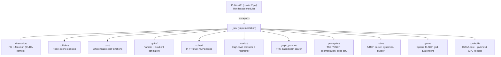

# cuRobo — Library Overview

cuRobo is a GPU-accelerated robot motion generation library built on PyTorch. It provides differentiable forward kinematics, collision-aware IK, trajectory optimization, MPC, and perception utilities — all designed to run in parallel on CUDA hardware.

## Architecture

## Key Design Patterns

| Pattern | Description |
|---------|-------------|
| **Façade / re-export** | Every top-level `curobo/*.py` is a thin public façade over `curobo/_src/` |
| **Cfg + Solver pair** | `*Cfg` dataclasses carry all hyperparameters; solver classes receive a `cfg` at construction |
| **Differentiable tensors** | All cost functions return GPU tensors with `.backward()` support |
| **CUDA kernel acceleration** | `curobolib/kernels/` → pybind11 + CUDA-core for FK, collision, L-BFGS, B-spline |
| **Warp kernels** | Collision scene, perception, and geometry use NVIDIA Warp for JIT-compiled GPU kernels |
| **Strategy / Protocol** | `optimizer_protocol.py`, `rollout_protocol.py` define structural subtypes |
| **Lazy optional imports** | `viewer.py` factory functions defer `viser`/`usd-core` imports |
| **Runtime feature flags** | `runtime.py` module-level booleans gate CUDA graphs, JIT, timers globally |

## Public Modules

| Module | Purpose |
|--------|---------|
| `kinematics` | Differentiable FK + Jacobian |
| `inverse_kinematics` | Collision-aware multi-seed IK |
| `trajectory_optimizer` | Collision-aware TrajOpt |
| `motion_planner` | Graph search + TrajOpt pipeline |
| `batch_motion_planner` | Batch multi-problem planning |
| `model_predictive_control` | Real-time MPC |
| `motion_retargeter` | IK+MPC humanoid retargeting |
| `collision_checking` | Standalone collision checker |
| `scene` | Scene representation with obstacles |
| `optim` | All optimizer primitives |
| `perception` | Depth filtering, TSDF/ESDF, pose estimation |
| `robot_builder` | URDF → cuRobo config builder |
| `robot_parser` | Low-level URDF parser |
| `sphere_fit` | Mesh → sphere approximation |
| `rollout` | Rollout protocol + Rosenbrock benchmark |
| `types` | Shared GPU tensor-backed data types |
| `config_io` | YAML / XRDF file I/O |
| `runtime` | Feature flags |
| `scene` | Obstacle/scene primitives |
| `viewer` | Viser 3D viewer + USD export |
| `profiling` | GPU event timer |
| `logging` | Logger helpers |

## Related Pages

- [[motion-planning]]
- [[inverse-kinematics]]
- [[kinematics]]
- [[collision-checking]]
- [[optimizers]]
- [[scene]]
- [[perception]]
- [[mpc]]
- [[motion-retargeter]]
- [[robot-builder]]
- [[types-and-config]]
- [[utilities]]
