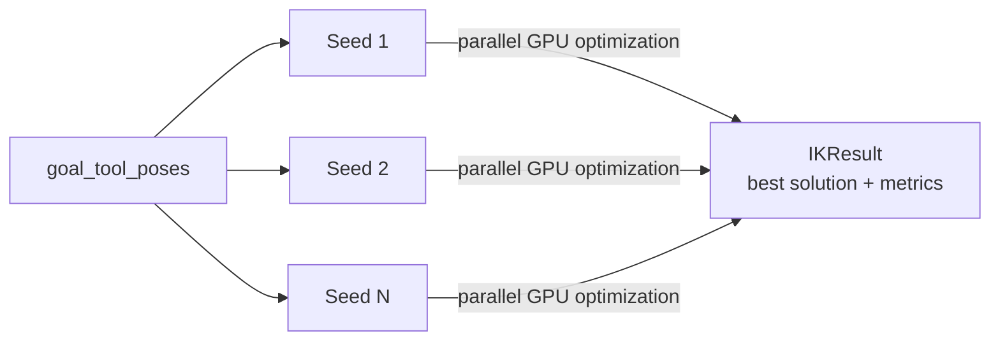

# Inverse Kinematics

`curobo/inverse_kinematics.py` → `curobo._src.solver.solver_ik`

Collision-aware IK using numerical optimization with **multiple random seeds** run in parallel on GPU.

## Key Classes

| Class | Role |
|-------|------|
| `IKSolver` | Main solver — runs multi-seed parallel IK |
| `IKSolverConfig` | Configuration dataclass |
| `IKResult` | Output: joint solutions + quality metrics |

## Key Method

```python
result = ik.solve_pose(goal_tool_poses)
```

## Configuration Parameters

| Parameter | Description |
|-----------|-------------|
| `robot_config: str` | Path to robot YAML/XRDF config |
| `num_seeds: int` | Number of random restarts for robustness |
| `collision_activation_distance: float` | Safety margin for collision costs |

## Multi-Seed Strategy



Seeds are generated from `_src/solver/seed_ik/` using Halton sequences and random sampling. The best solution across all seeds is returned.

## Seed Generation (`_src/solver/seed_ik/`)

Halton sequences and random samplers from `_src/util/sampling/` provide diverse starting configurations to avoid local minima.

## Related Pages

- [[curobo-overview]]
- [[kinematics]]
- [[motion-planning]]
- [[types-and-config]]
