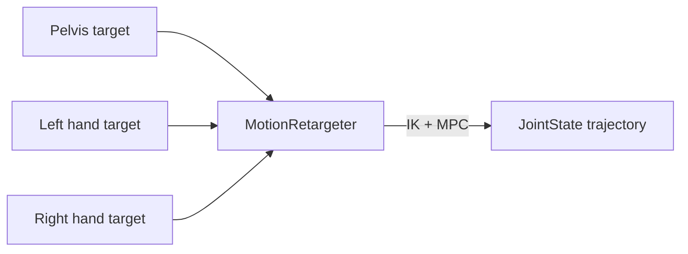

# Motion Retargeter

`curobo/motion_retargeter.py` → `curobo._src.motion.motion_retargeter`

IK + MPC-based motion retargeting — converts per-frame tool pose targets to joint trajectories. Especially suited for **humanoid robots** with multi-link tracking requirements (e.g., pelvis + both hands).

## Key Classes

| Class | Role |
|-------|------|
| `MotionRetargeter` | Main retargeter |
| `MotionRetargeterConfig` | Configuration dataclass |
| `MotionRetargeterResult` | Output joint trajectory |
| `ToolPoseCriteria` | Per-link tracking weight specification |
| `ToolPoseCriteriaConfig` | Config for `ToolPoseCriteria` |
| `RetargetingFrame` | Specifies a single link's target pose + weights |

## Key Method

```python
result = retargeter.solve_frame(goal_tool_pose)
```

## ToolPoseCriteria

Separates **position** and **orientation** tracking weight specification per link:

| Field | Description |
|-------|-------------|
| `xyz_weight` | Weight for position tracking per axis |
| `rpy_weight` | Weight for orientation tracking per axis |
| `link_name` | Which link to track |

## Multi-Link Retargeting



Cost function (`_src/cost/cost_support_polygon.py`) enforces support polygon constraints for balance during retargeting.

## Related Pages

- [[curobo-overview]]
- [[mpc]]
- [[inverse-kinematics]]
- [[kinematics]]
