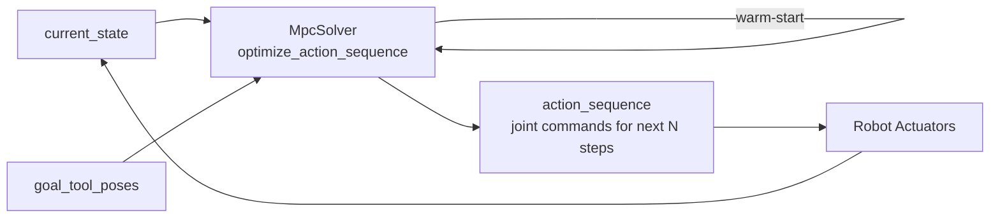

# Model Predictive Control (MPC)

`curobo/model_predictive_control.py` → `curobo._src.solver.solver_mpc`

Real-time MPC for trajectory tracking with warm-start optimization and obstacle avoidance. Designed for **closed-loop control** — each iteration warm-starts from the previous solution.

## Key Classes

| Class | Role |
|-------|------|
| `MpcSolver` | Main MPC solver |
| `MpcSolverConfig` | Configuration dataclass |
| `MpcResult` | Output: `action_sequence` + metrics |

## Key Methods

```python
mpc.setup(current_state)
mpc.update_goal_tool_poses(poses_dict)
result = mpc.optimize_action_sequence(current_state)
# result.action_sequence → next N joint commands
```

## Configuration Parameters

| Parameter | Description |
|-----------|-------------|
| `robot_config: str` | Robot YAML/XRDF path |
| `scene_model: str` | Scene description |
| `optimization_dt: float` | Time step for action sequence |
| `interpolation_steps: int` | Number of steps in the action horizon |

## Control Loop



## Optimizer Backend

MPC internally uses the [[optimizers]] infrastructure, typically MPPI (particle-based) for the sampling phase, followed by gradient refinement via L-BFGS.

## Related Pages

- [[curobo-overview]]
- [[optimizers]]
- [[motion-retargeter]]
- [[types-and-config]]
