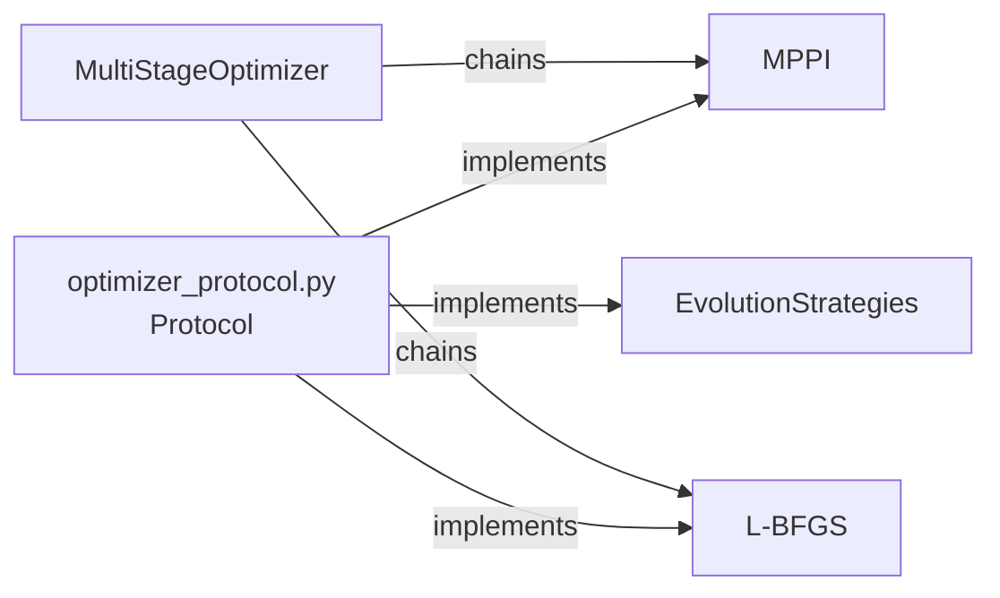

# Optimizers

`curobo/optim.py` → `curobo._src.optim`

Public surface for all underlying optimizers. Supports building custom optimization pipelines by mixing particle-based and gradient-based methods.

## Optimizer Families

### Particle-Based (`_src/optim/particle/`)

| Class | Description |
|-------|-------------|
| `MPPI` / `MPPIConfig` | Model Predictive Path Integral — samples action sequences, weights by cost |
| `EvolutionStrategies` / `ESConfig` | CMA-ES style evolution |
| `STOMP` / `STOMPConfig` | Stochastic Trajectory Optimization for Motion Planning |

### Gradient-Based (`_src/optim/gradient/`)

| Class | Description |
|-------|-------------|
| `LBFGSOptimizer` / `LBFGSConfig` | Limited-memory BFGS (CUDA kernel-accelerated) |
| `LSR1Optimizer` / `LSR1Config` | Limited-memory SR1 quasi-Newton |
| `CGOptimizer` / `CGConfig` | Conjugate Gradient |
| `GradientDescent` / `GDConfig` | Plain SGD with line search |

### External Wrappers (`_src/optim/external/`)

| Class | Description |
|-------|-------------|
| `ScipyOptimizer` | Wraps SciPy optimizers for CPU fallback |
| `TorchOptimizer` | Wraps PyTorch built-in optimizers |

### Multi-Stage

| Class | Description |
|-------|-------------|
| `MultiStageOptimizer` | Chains multiple optimizers sequentially (e.g., MPPI seed → L-BFGS refine) |

## Strategy Pattern

All optimizers conform to `optimizer_protocol.py` structural subtype:

## Shared Components (`_src/optim/components/`)

| Component | Description |
|-----------|-------------|
| Bounds manager | Enforces joint/action limits during optimization |
| Best tracker | Tracks best solution across iterations |
| Gaussian distribution | Parameterizes particle distributions |
| Buffers | Pre-allocated GPU tensor buffers |

## Related Pages

- [[curobo-overview]]
- [[motion-planning]]
- [[mpc]]
- [[inverse-kinematics]]
