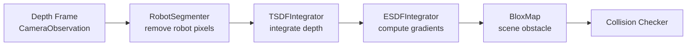

# Perception

`curobo/perception.py` → `curobo._src.perception`

Sensor processing utilities: robot segmentation, volumetric mapping (TSDF/ESDF), and object pose estimation. All backed by NVIDIA Warp JIT-compiled GPU kernels.

## Key Classes

### Robot Segmentation

| Class | Description |
|-------|-------------|
| `RobotSegmenter` | Removes robot pixels from depth images using rendered robot masks |

**Key method:**
```python
mask, filtered_depth = segmenter.get_robot_mask(camera_obs, joint_state)
```

### Volumetric Mapping (`_src/perception/mapper/`)

| Class | Description |
|-------|-------------|
| `TSDFIntegrator` | Integrates depth images into a Truncated Signed Distance Field |
| `ESDFIntegrator` | Computes Euclidean SDF from TSDF for smooth collision gradients |
| `MapStorage` | GPU voxel grid memory management |
| `MapRenderer` | Renders map to depth/normal images |

### Pose Estimation (`_src/perception/pose_estimation/`)

| Class | Description |
|-------|-------------|
| `MeshPoseDetector` | Mesh-based object pose alignment |
| `SDFPoseDetector` | SDF-based object pose alignment |

**Key method:**
```python
pose = detector.detect(pointcloud)
```

## Input Types

| Type | Description |
|------|-------------|
| `CameraObservation` | Depth image + intrinsics + camera pose |
| `PointCloud` | 3D point cloud for pose estimation |

## Volumetric Mapping Pipeline



## Related Pages

- [[curobo-overview]]
- [[scene]]
- [[types-and-config]]
