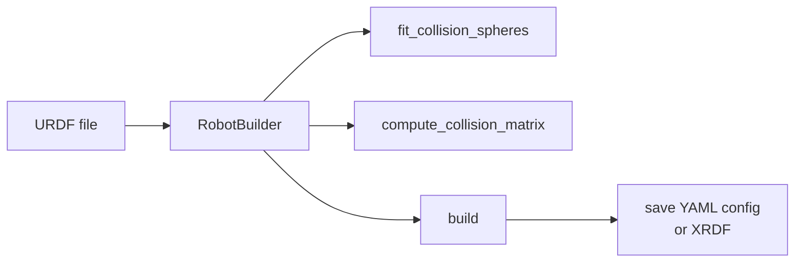

# Robot Builder & Parser

- `curobo/robot_builder.py` → `curobo._src.robot.builder`
- `curobo/robot_parser.py` → `curobo._src.robot.parser`

Tools for converting URDF robot descriptions into cuRobo-compatible configurations.

## Robot Builder

### Key Classes

| Class | Role |
|-------|------|
| `RobotBuilder` | Builds/exports cuRobo robot configs from URDF |
| `RobotBuilderDebugger` | Validates configs (collision checks, retract pose) |

### Builder Pattern Workflow

### Key Methods

| Method | Description |
|--------|-------------|
| `fit_collision_spheres()` | Approximates each link with spheres for GPU collision |
| `compute_collision_matrix()` | Determines which link pairs can collide |
| `build()` | Assembles complete cuRobo robot config |
| `save(config, path)` | Exports to cuRobo YAML format |
| `save_xrdf(config, path)` | Exports to XRDF (Isaac Sim exchange format) |
| `refit_link_spheres(link_name, sphere_density)` | Refines sphere fit for specific link |

### Debugger Methods

| Method | Returns |
|--------|---------|
| `check_retract_collision()` | `{has_collision, num_colliding_pairs}` |

## Robot Parser

Low-level URDF parser producing link/joint data structures consumed by `RobotBuilder`. Most users don't call this directly.

### Key Class

| Class | Role |
|-------|------|
| `RobotParser` | Parses URDF into cuRobo link/joint structures |

**Key methods:** `parse_urdf()`, `get_joint_limits()`

## XRDF Format

XRDF is NVIDIA Isaac Sim's robot description exchange format. `RobotBuilder.save_xrdf()` enables direct use of cuRobo-built configs in Isaac Sim workflows.

## Related Pages

- [[curobo-overview]]
- [[kinematics]]
- [[sphere-fit-and-rollout]]
- [[types-and-config]]
