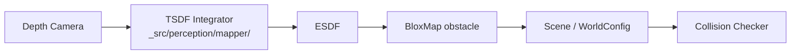

# Scene

`curobo/scene.py` → `curobo._src.geom.data`

Scene representation with obstacle primitives for collision checking. Scenes are composed of typed obstacle objects sharing a common base.

## Key Classes

| Class | Description |
|-------|-------------|
| `WorldConfig` | Top-level scene config (alias of internal type) |
| `Cuboid` | Axis-aligned box obstacle |
| `Mesh` | Mesh-based obstacle (loaded from file) |
| `Sphere` | Sphere obstacle |
| `Cylinder` | Cylinder obstacle |
| `Capsule` | Capsule obstacle |
| `BloxMap` | Occupancy-based map (from TSDF/ESDF mapper) |
| `VoxelGrid` | Voxel grid representation |
| `Obstacle` | Abstract base — all obstacle types derive from this |

## Obstacle Structure

Every obstacle has:

| Field | Description |
|-------|-------------|
| `name: str` | Unique identifier |
| `pose` | SE(3) position + quaternion (w, x, y, z) |
| `dims` / `radius` / `file_path` | Shape-specific parameters |

## Key Methods

```python
scene = WorldConfig(cuboid=[...], mesh=[...])
scene.add_obstacle(obstacle)
scene.remove_obstacle(name)
```

## BloxMap / Volumetric Integration

`BloxMap` connects the scene to the [[perception]] pipeline's TSDF/ESDF mapper, enabling real-time obstacle updates from depth sensors.



## Related Pages

- [[curobo-overview]]
- [[collision-checking]]
- [[perception]]
